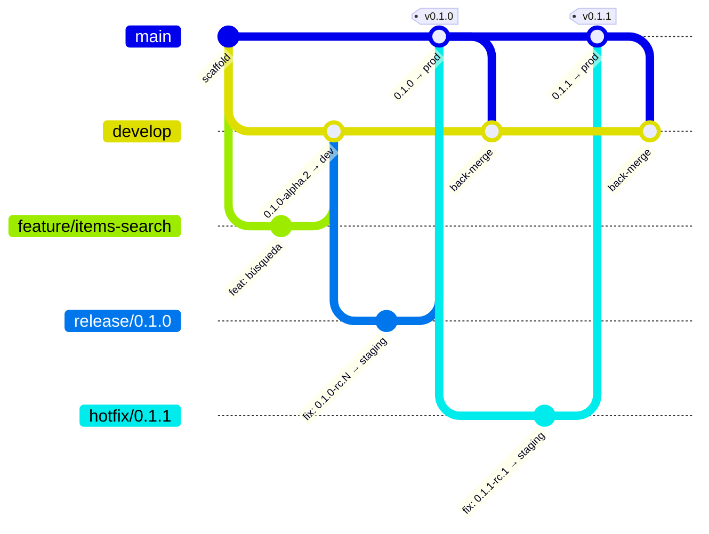
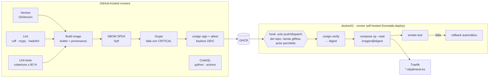

# Lifecycle Lab

Laboratorio para enseñar el **ciclo de vida completo de una aplicación en contenedores**: gitflow como estrategia de ramas, SemVer calculado desde git, CI con calidad y seguridad, cadena de suministro verificable (SBOM, escaneo, firma) y despliegue en tres entornos de un homelab con aprobación y rollback.

La aplicación es deliberadamente tonta (FastAPI con `/items` en memoria). Lo importante es el camino que recorre.

| Entorno | Rama | Versión de ejemplo | URL |
|---|---|---|---|
| dev | `develop` | `0.3.0-alpha.4` | https://lab-dev.elpalmeral.es/docs |
| staging | `release/*`, `hotfix/*` | `0.3.0-rc.2` | https://lab-staging.elpalmeral.es/docs |
| prod | `main` (tag `vX.Y.Z`) | `0.3.0` | https://lab.elpalmeral.es/docs |

## Gitflow y versiones



- **La versión no se escribe a mano.** [GitVersion](GitVersion.yml) la calcula con el preset `GitFlow/v1`: el nombre de la rama `release/X.Y.Z` fija la versión, `develop` va una *minor* por delante con sufijo `alpha`, y los Conventional Commits (`feat!:` / `BREAKING CHANGE:`) suben la *major*.
- **Merges:** `feature/*` → `develop` con *squash* (el título del PR, validado como Conventional Commit, es el commit); `release/*` y `hotfix/*` → `main` con *merge commit* (GitVersion lee la versión del mensaje del merge).
- Las reglas de origen → destino las valida [`pr-policy.yml`](.github/workflows/pr-policy.yml); las protecciones de `main`, `develop` y los tags `v*` están en *rulesets* del repo.

## Pipeline



| Evento | Qué pasa |
|---|---|
| PR | Versión, lint, tests, build, SBOM y escaneo **sin publicar**. Gitflow guard y título Conventional. CodeQL. |
| push `develop` | Publica `X.Y.Z-alpha.N` firmada → despliega **dev** |
| push `release/*` / `hotfix/*` | Publica `X.Y.Z-rc.N` (+ tag `tree-<hash>`) firmada → despliega **staging** |
| push `main` | **Promociona** la imagen rc ya probada (mismo digest, sin rebuild) a `X.Y.Z`, `X.Y`, `X`, `latest` → tag `vX.Y.Z` + GitHub Release con notas (git-cliff) y SBOM → **aprobación manual** → despliega **prod** → abre PR de back-merge a `develop` |
| Actions → Deploy (manual) | Despliega cualquier versión firmada en un entorno: es el **rollback** |

### Build once, promote

La imagen de producción es *byte a byte* la que se validó en staging. En gitflow el merge de `release/X.Y.Z` en `main` produce un commit nuevo pero con el **mismo árbol** de ficheros, así que el pipeline busca la imagen `tree-<hash del árbol>` y la re-etiqueta. Por eso `/version` muestra:

```json
{ "version": "0.2.0", "build": { "built_as": "0.2.0-rc.2", "git_ref": "release/0.2.0", "git_sha": "…" } }
```

`version` lo fija el despliegue; `built_as` es con lo que se construyó.

### Supply chain

- Actions fijadas por **SHA**, imágenes base por **digest**, `uv.lock` con hashes. Dependabot propone las actualizaciones contra `develop`.
- Por qué importa: en marzo de 2026 se reescribieron 76 de 77 tags de `aquasecurity/trivy-action` para apuntar a código malicioso ([Aqua](https://www.aquasec.com/blog/trivy-supply-chain-attack-what-you-need-to-know)). Quien fijaba por SHA no se vio afectado.
- Verificar una imagen a mano:

```bash
cosign verify ghcr.io/virgo1985/fastapi-lifecycle-lab:0.2.0 \
  --certificate-oidc-issuer https://token.actions.githubusercontent.com \
  --certificate-identity-regexp '^https://github.com/virgo1985/fastapi-lifecycle-lab/\.github/workflows/ci\.yml@refs/heads/'
cosign verify-attestation --type spdxjson … # mismo filtro: SBOM firmado
```

## Puesta en marcha en el homelab

Ver [docs/setup.md](docs/setup.md) (runner, DNS, PAT) y el guion de demo en [docs/demo.md](docs/demo.md).

## Desarrollo local

```bash
uv sync
uv run pytest
uv run uvicorn app.main:app --reload    # http://127.0.0.1:8000/docs
docker build -t lab . && docker run --rm -p 8000:8000 lab
```
