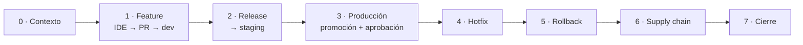

# Guion de la demo

**Objetivo:** enseñar el ciclo de vida completo de una aplicación en contenedores, del IDE a producción y vuelta atrás, con gitflow, SemVer automático y una cadena de suministro verificable.

**Público:** equipos de desarrollo, plataforma o seguridad y responsables técnicos. La app es deliberadamente simple, para que la atención esté en el proceso.

| Formato | Actos | Duración |
|---|---|---|
| Completa | 0 → 7 | ≈ 50 min |
| Express | 0, 1, 3 y 7 (sin hotfix ni rollback) | ≈ 25 min |

Convenciones del guion:

- `▶` es lo que haces.
- 👀 es lo que se ve.
- 💬 es lo que dices (orientativo, no para leer).
- ⏱ son los tiempos de espera aproximados del pipeline. Úsalos para explicar.



---

## Antes de la demo

### La víspera

- [ ] Decide si empiezas **de cero** o **continúas**. Para empezar de cero: `scripts/demo.sh reset --delete-images --purge-history --teardown` (ver [Después de la demo](#después-de-la-demo)). Tras un reset, la primera release es `0.1.0`.
- [ ] Ensayo rápido del acto 1 y `scripts/demo.sh abort` para dejarlo limpio. Así calientas la caché de CI y compruebas que el runner responde.
- [ ] Graba un vídeo de una vuelta completa como plan B, por si falla la red.

### 30 minutos antes

```bash
cd ~/git/homelab/fastapi-lifecycle-lab
git switch develop && git pull
scripts/demo.sh status        # qué versión sirve cada entorno
scripts/flow.sh next          # qué versión saldrá en la release y en el hotfix
gh pr list                    # sin PR olvidados (salvo Dependabot, que viene bien enseñar)
```

- [ ] Runner online: *Settings → Actions → Runners*, `docker01-…` en estado **Idle**.
- [ ] VPN WireGuard activa si no estás en casa: los dominios `lab*.elpalmeral.es` solo resuelven con el DNS de casa.
- [ ] El IDE abierto en el repo con la vista **Source Control** a mano. La fuente del terminal y del IDE, a 16–18 pt.

### Pestañas del navegador, en este orden

1. Repo → **Pull requests**
2. Repo → **Actions**
3. `https://lab-dev.elpalmeral.es/docs`
4. `https://lab-staging.elpalmeral.es/docs`
5. `https://lab.elpalmeral.es/version`
6. Repo → **Packages** (GHCR) y **Security → Code scanning**

---

## Acto 0 · Contexto (3 min)

▶ Abre el `README.md` en GitHub y baja hasta el diagrama de gitflow.

💬 *"Vamos a seguir un cambio pequeño desde el IDE hasta producción. La app no importa, es una API tonta; importa todo lo que pasa alrededor. Cuatro ideas: la versión no se escribe a mano, sale de git; cada rama sabe a qué entorno va; la imagen que llega a producción es exactamente la que se probó; y cualquiera puede verificar quién la construyó y qué lleva dentro."*

▶ Señala la tabla de entornos: `develop` → dev, `release/*` y `hotfix/*` → staging, `main` → prod.

---

## Acto 1 · Una feature: del IDE a dev (12 min)

### 1.1 El cambio en el IDE

```bash
scripts/demo.sh feature
```

👀 El script:

1. Crea la rama `feature/<cambio>` desde `develop`.
2. Escribe el código y los tests **sin commitear**.
3. Abre el IDE con los ficheros cambiados.

En la primera vuelta el cambio es `feature/items-search`: un endpoint `GET /items/search` y el fichero `tests/test_items_search.py`.

▶ En el IDE, vista **Source Control**: abre el diff de `app/main.py` y el test nuevo.

💬 *"Esto es lo que haría un desarrollador: un endpoint nuevo y sus tests. Fijaos en que el test describe el comportamiento: busca sin distinguir mayúsculas y exige el parámetro."*

<details><summary>Si alguien pregunta "¿y quién ha escrito esto?"</summary>

Viene de un catálogo (`scripts/demo_changes.py`) para que la demo sea repetible. Cada vuelta aplica el siguiente cambio: búsqueda, estadísticas, saludo personalizado, uptime y, después, un saludo nuevo en `/hello` en cada vuelta.
</details>

### 1.2 Shift-left: las comprobaciones en local

```bash
scripts/demo.sh pr
```

👀 El script:

1. Pasa en local **las mismas comprobaciones que CI**: ruff (estilo y reglas de seguridad), formato, mypy estricto y pytest con cobertura ≥ 80 %.
2. Hace commit con un título Conventional Commits (`feat(items): búsqueda por nombre`).
3. Hace push y abre el PR contra `develop`.

💬 *"Si esto falla aquí, no molestamos al pipeline. El título del commit no es decorativo: `feat:` sube la minor, `fix:` la patch, y `feat!:` o `BREAKING CHANGE:` la major. De él salen la versión y las notas de la release."*

### 1.3 El PR (⏱ 3–4 min de checks)

▶ Pestaña **Pull requests** → abre el PR.

👀 Checks:

| Check | Qué enseñar |
|---|---|
| **Gitflow guard** | Valida el origen y el destino. Quedará en rojo en la prueba de abajo |
| **Conventional PR title** | Con *squash merge*, el título será el commit en `develop` |
| **Version** | Resumen del job: `0.1.0-PullRequestN.M`, la versión que tendría este PR |
| **Lint**, **Unit tests** | La cobertura sale en el resumen del run |
| **Build image** | Construye y escanea, pero **no publica**: un PR no llega al registro |
| **CodeQL** | SAST de Python y de los propios workflows |

▶ Mientras corren, la **prueba del guard**: *Edit* → cambia la base del PR a `main` → 👀 *Gitflow guard* falla con *"Gitflow no permite feature/… → main"* → vuelve a poner `develop`.

💬 *"Una feature no puede ir directa a producción. No es una norma en una wiki: el sistema no lo deja."*

▶ Cuando termine, abre el run → artefacto **sbom** y pestaña **Security → Code scanning**, categoría *grype*.

💬 *"Cada build genera su SBOM: la lista de todo lo que hay en la imagen, incluido el sistema operativo base. Grype la cruza con bases de vulnerabilidades y bloquea si hay algo crítico con arreglo disponible."*

### 1.4 Merge y despliegue en dev (⏱ ~5 min hasta dev)

▶ **Squash and merge**.

▶ Pestaña **Actions** → run de `develop`.

👀 En el resumen del job **Build image**:

- `📦 ghcr.io/virgo1985/fastapi-lifecycle-lab:0.1.0-alpha.N` con su digest.
- `🔏 Firmado con identidad …/ci.yml@refs/heads/develop`.

💬 *"Ahora sí se publica. La imagen se firma sin claves que custodiar: GitHub certifica qué workflow, de qué repo y de qué rama la construyó, y queda registrado en un log público de transparencia (Sigstore)."*

▶ Abre el job **Deploy dev / dev ← 0.1.0-alpha.N**. Se ejecuta **en casa**, en docker01. Recorre los pasos:

| Paso | Qué decir |
|---|---|
| `Runner homelab: job aceptado (push refs/heads/develop por virgo1985)` | Un hook en el runner rechaza todo lo que no sea un push del propio repo, en ramas de gitflow y por actores autorizados. El repo es público y este runner tiene acceso a Docker |
| Política de versiones por entorno | dev acepta `-alpha`; prod solo versiones finales |
| Verificar firma (cosign keyless) y resolver digest | No se despliega nada que no esté firmado por **este** pipeline, y se despliega por digest, no por tag |
| docker compose up | `--wait` espera al healthcheck del contenedor |
| Smoke test | Llama a `/version` y hace un alta y una baja en `/items`. Si falla, el siguiente paso hace rollback automático |

▶ Pestaña `lab-dev…/docs` → recarga → 👀 el endpoint nuevo en Swagger → *Try it out*: crea un item y búscalo.

💬 *"Del IDE a un entorno real en cinco minutos, sin que nadie haya tocado un servidor."*

---

## Acto 2 · Release candidate en staging (6 min)

```bash
scripts/flow.sh release start      # sin versión: la calcula (0.1.0, 0.2.0… o 1.0.0 si hubo un feat!)
```

👀 `release/X.Y.Z creada: el pipeline publicará X.Y.Z-rc.N y desplegará en staging`.

💬 *"Congelamos lo que hay en develop. El nombre de la rama fija la versión, y GitVersion hace el resto: cada push a esta rama genera una release candidate nueva."*

▶ **Actions** → run de `release/X.Y.Z` → 👀 `X.Y.Z-rc.N`, despliegue en **staging**.

▶ *(Opcional, +3 min)* Para enseñar que cada arreglo genera un rc nuevo: edita algo pequeño (un texto en `app/main.py`), haz `git commit -am "fix: …"` y `git push` → `rc.N+1`.

▶ Mientras despliega, explica la etiqueta `tree-<hash>` en GHCR (pestaña **Packages**):

💬 *"Además de la versión, la imagen se etiqueta con el hash del árbol de ficheros. Así, cuando esto llegue a main, encontraremos exactamente esta imagen."*

▶ `lab-staging…/version` → 👀 `X.Y.Z-rc.N`.

---

## Acto 3 · Producción: promoción y aprobación (8 min)

```bash
scripts/flow.sh release finish     # PR release/X.Y.Z → main
```

▶ En el PR: **Create a merge commit** (no squash).

💬 *"A main solo se llega con un merge de una release o de un hotfix. El propio repo impide otros métodos de merge."*

▶ **Actions** → run de `main`. Recórrelo en este orden:

1. **Build image** → resumen `♻️ Promoción: tree-… → X.Y.Z (sin rebuild)`.
   💬 *"No reconstruimos. Re-etiquetamos la imagen que ya pasó staging: mismo digest, mismos bytes. Reconstruir en main sería desplegar algo que nadie ha probado."*
   ▶ En **Packages**, compara el digest de `X.Y.Z` y el de `X.Y.Z-rc.N`: es el mismo.
2. **Tag & GitHub Release** → abre **Releases**: notas agrupadas por tipo (Funcionalidades, Correcciones…) y el SBOM adjunto.
3. **Deploy prod** → 👀 *Waiting for review*. ▶ *Review deployments* → **Approve**.
   💬 *"Producción tiene puerta. Aquí podría estar la aprobación de un CAB, una ventana de cambios o un segundo par de ojos."*
4. **Back-merge main → develop** → el bot abre un PR. ▶ Fusiónalo con **merge commit**.
   💬 *"Gitflow exige que lo publicado vuelva a develop. Lo automatizamos para que nadie lo olvide."*

▶ `lab.elpalmeral.es/version` → 👀:

```json
{ "version": "X.Y.Z", "build": { "built_as": "X.Y.Z-rc.N", "git_ref": "release/X.Y.Z" } }
```

💬 *"Producción dice X.Y.Z, y la propia imagen confiesa que se construyó como la rc que validamos en staging. Build once, deploy many."*

---

## Acto 4 · Hotfix (7 min)

💬 *"Ha salido un bug en producción: se pueden crear items con un nombre en blanco."*

▶ *(Opcional)* Demuéstralo en `lab…/docs`: `POST /items` con `{"name": "   "}` → 201.

```bash
scripts/demo.sh hotfix        # hotfix/X.Y.Z+1 desde main, con el arreglo y su test sin commitear
```

▶ En el IDE: una línea (`str_strip_whitespace=True`) y un test que reproduce el bug.

💬 *"El hotfix sale de main, no de develop. Lo que hay en develop todavía no está listo para producción y no debe colarse."*

```bash
scripts/demo.sh pr            # checks locales, commit y push → staging recibe X.Y.(Z+1)-rc.1
```

▶ Valida en `lab-staging…/docs`: el mismo POST devuelve ahora 422.

```bash
scripts/flow.sh hotfix finish # PR hotfix → main (merge commit) → promoción, tag, aprobación, prod
```

▶ Repite los pasos del acto 3, más rápido: aprobación → prod → back-merge.

---

## Acto 5 · Rollback (4 min)

💬 *"El hotfix ha roto otra cosa y hay que volver ya a la versión anterior."*

▶ **Actions → Deploy → Run workflow**: rama `main`, entorno `prod`, versión **anterior** (p. ej. `0.1.0`).

👀 Las mismas puertas que un despliegue normal: firma, despliegue por digest y smoke test. `lab…/version` vuelve a la versión anterior.

💬 *"Un rollback es un despliegue más de algo que ya está firmado. No hay que reconstruir ni tocar git."*

▶ **Prueba de la política:** lanza el mismo workflow con `prod` y una `-alpha` → 👀 *"prod solo admite versiones finales"*.

▶ Deja prod en la última versión (otro *Run workflow* con la versión del hotfix).

> **Rollback automático:** si el smoke test de un despliegue falla, el job vuelve solo a la imagen anterior y lo indica en el resumen (`⏪ Rollback a …`). Se cuenta, no se fuerza en directo.

---

## Acto 6 · Supply chain (5 min)

En el terminal, con `cosign` instalado (`brew install cosign`):

```bash
V=X.Y.Z
cosign verify ghcr.io/virgo1985/fastapi-lifecycle-lab:$V \
  --certificate-oidc-issuer https://token.actions.githubusercontent.com \
  --certificate-identity-regexp '^https://github.com/virgo1985/fastapi-lifecycle-lab/' | jq '.[0].optional'

cosign verify-attestation --type spdxjson ghcr.io/virgo1985/fastapi-lifecycle-lab:$V \
  --certificate-oidc-issuer https://token.actions.githubusercontent.com \
  --certificate-identity-regexp '^https://github.com/virgo1985/fastapi-lifecycle-lab/' > /dev/null && echo "SBOM firmado ✔"
```

💬 *"Cualquiera, sin pedirnos nada, puede comprobar quién construyó esta imagen, desde qué commit y con qué dependencias."*

▶ Abre `.github/workflows/ci.yml` y enseña una línea `uses: …@<sha> # vX.Y.Z`.

💬 *"Todas las piezas de terceros están fijadas por hash, no por versión. En marzo de 2026 atacaron `trivy-action`, una de las actions de seguridad más usadas: reescribieron 76 de sus 77 tags para que apuntaran a código malicioso. Quien la usaba por tag ejecutó ese código; quien la tenía fijada por hash, no. Dependabot nos propone las actualizaciones como PR contra develop, y entran por el mismo proceso que cualquier cambio."* ▶ Enseña un PR de Dependabot si hay alguno abierto.

---

## Acto 7 · Cierre (3 min)

| Fase | Qué hemos visto |
|---|---|
| Plan / código | Gitflow con ramas que el sistema hace cumplir; PR con plantilla; CODEOWNERS |
| Build | Una imagen por commit publicable; versión SemVer calculada desde git |
| Test / calidad | ruff, mypy, pytest y cobertura, en local y en CI |
| Seguridad | CodeQL (SAST), Grype sobre el SBOM, reglas de seguridad de ruff |
| Release | Tag, notas automáticas, SBOM, firma y provenance |
| Deploy | Entornos por rama, aprobación en prod, verificación de firma, despliegue por digest |
| Operate | `/health`, `/ready`, `/metrics` (Prometheus), rollback automático y manual |

💬 *"Nada de esto depende de la herramienta. Mañana puede ser GitLab, Azure DevOps o Argo CD: las prácticas son las mismas."*

### Preguntas frecuentes

| Pregunta | Respuesta corta |
|---|---|
| ¿Por qué gitflow y no trunk-based? | Gitflow encaja con releases versionadas y varios entornos (producto, cliente regulado). Para despliegue continuo de un servicio interno, trunk-based es más ligero: el mismo pipeline sirve quitando develop y release |
| ¿Por qué no reconstruir en main? | Porque desplegarías algo distinto de lo probado. Las dependencias y las imágenes base cambian entre dos builds |
| ¿Un runner propio con acceso a Docker no es peligroso? | Sí; equivale a root en esa máquina. Por eso hay un hook de admisión, un runner efímero y aprobación para PR externos. En producción iría en una VM o un clúster aislado |
| ¿Y Kubernetes? | Cambia el último paso (`kubectl`, Helm o Argo CD en lugar de compose). Versión, firma, SBOM y promoción se quedan igual. Con Kyverno o la policy-controller de Sigstore, la verificación de firma la haría el propio clúster |
| ¿Y los secretos? | Este lab no los necesita: la firma es *keyless* (OIDC) y el token del registro es efímero. En un caso real irían en un vault o en los secretos de entorno, nunca en el repo |

---

## Plan B · Problemas típicos

| Síntoma | Causa probable | Qué hacer |
|---|---|---|
| `Deploy …` se queda en *Queued* | Runner apagado o sin registrar | `sudo docker logs gh-runner-lifecycle-lab` en docker01; *Restart* del stack en Portainer |
| `Deploy` falla en *Runner homelab: job RECHAZADO* | Evento, rama o actor no permitido (p. ej. un PR) | Es lo esperado: enséñalo como medida de seguridad |
| `lab…` no carga | DNS o VPN | `dig lab-dev.elpalmeral.es`; comprueba WireGuard |
| `demo.sh feature`: *ya existe en GitHub* | Un PR de una vuelta anterior sin fusionar | Fusiónalo o ciérralo y borra la rama |
| `demo.sh pr` falla en las comprobaciones | Has editado el código a mano | Corrígelo o `scripts/demo.sh abort` y vuelve a empezar |
| Build image falla en Grype | Ha salido una CVE crítica nueva en la imagen base | Momento didáctico: enséñalo en *Security* y aplica el PR de Dependabot |
| GitHub Actions caído o lento | — | Pasa al vídeo de plan B |

---

## Después de la demo

| Quiero… | Comando |
|---|---|
| **Otra vuelta**, continuando la historia | Nada: repite el guion. `demo.sh feature` aplica el siguiente cambio del catálogo y las versiones siguen subiendo |
| **Descartar** un cambio a medias, sin subir | `scripts/demo.sh abort` |
| **Volver a cero** (siguiente release = `0.1.0`) | `scripts/demo.sh reset --delete-images --purge-history --teardown` |

### Reset completo

Hay que marcar la línea base una vez, y repetirlo cada vez que cambies el pipeline o la app y quieras que forme parte del punto de partida:

```bash
scripts/demo.sh baseline           # tag demo-baseline = origin/develop
```

Para volver a cero:

```bash
gh auth refresh -h github.com -s read:packages,delete:packages   # solo la 1.ª vez, para --delete-images
scripts/demo.sh reset --delete-images --purge-history --teardown
```

El reset:

1. Desactiva los rulesets y los reactiva al final, aunque algo falle.
2. Cierra los PR y borra todas las ramas salvo `main` y `develop`.
3. Borra las releases y los tags `v*`.
4. Con las opciones: borra las imágenes de GHCR, el historial de runs y despliegues, y los contenedores `lab-*` en docker01.
5. Fuerza `main` y `develop` a `demo-baseline` y limpia tu clon local.

Como el catálogo se evalúa contra el código, tras un reset vuelve a empezar por el primer cambio.

### Catálogo de cambios (`scripts/demo_changes.py`)

| Orden | Tipo | Cambio | Ficheros |
|---|---|---|---|
| 1 | feature | `GET /items/search?q=` | `app/main.py`, `tests/test_items_search.py` |
| 2 | feature | `GET /items/stats` | `app/main.py`, `tests/test_items_stats.py` |
| 3 | feature | `GET /hello/{name}` | `app/main.py`, `tests/test_hello_name.py` |
| 4 | feature | `GET /uptime` | `app/main.py`, `tests/test_uptime.py` |
| 5+ | feature | Saludo de la vuelta N en `/hello` | `app/greetings.py` |
| 1 | hotfix | Rechazar nombres en blanco | `app/main.py`, `tests/test_item_name_whitespace.py` |
| 2 | hotfix | Rechazar ids ≤ 0 | `app/main.py`, `tests/test_item_ids.py` |

Cuando se acaban los hotfixes, toca un reset. Para añadir un cambio nuevo, crea una función más en el catálogo; se aplican en orden.

### Referencia de comandos

| Comando | Qué hace |
|---|---|
| `scripts/demo.sh feature` | Rama `feature/<cambio>` + código y tests sin commitear + abre el IDE |
| `scripts/demo.sh hotfix` | Rama `hotfix/X.Y.Z+1` desde main + arreglo y test sin commitear |
| `scripts/demo.sh pr ["título"]` | Checks locales + commit + push (+ PR a develop si es una feature) |
| `scripts/demo.sh abort` | Descarta el cambio y la rama local |
| `scripts/demo.sh status` | Versión servida en dev, staging y prod |
| `scripts/flow.sh next` | Próximas versiones de release y hotfix |
| `scripts/flow.sh release start\|finish` | Rama `release/X.Y.Z` / PR a main |
| `scripts/flow.sh hotfix finish` | PR del hotfix a main |
| `scripts/demo.sh baseline` / `reset` | Línea base / volver a cero |

Variables: `DEMO_NO_IDE=1` evita abrir el IDE, `DEMO_IDE=cursor` usa otro editor y `LAB_SSH=usuario@host` cambia el host del `--teardown`.
